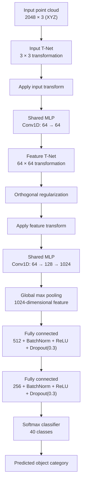
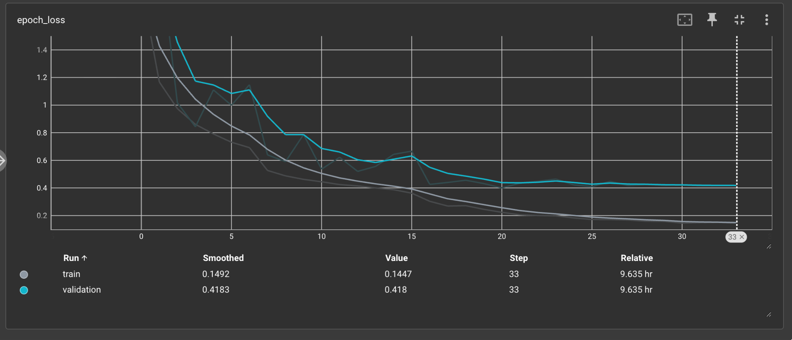
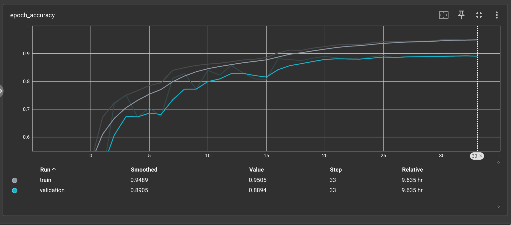
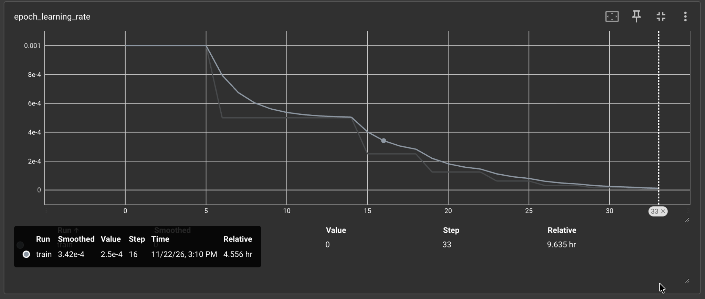

# PointNet Classification on ModelNet40

This project implements a **PointNet classification network** using TensorFlow/Keras and trains it on the ModelNet40 point-cloud dataset.

## Environment

- **Python:** 3.13.9
- **Framework:** TensorFlow / Keras
- **Dataset:** ModelNet40, HDF5 point clouds
- **Input:** 2,048 points per object, with XYZ coordinates
- **Output:** 40 object categories

## Hardware used for training

The model was trained on the following machine:

| Component | Specification |
|---|---|
| Device | Apple MacBook Air |
| Chip | Apple M2 |
| Unified memory | 8 GB |
| Storage | 256 GB SSD |
| Training time | **595 minutes** (approximately 9 hours 55 minutes) |

Training was configured for a maximum of **50 epochs**, but it stopped at **epoch 34/50** because the EarlyStopping callback condition was met. The complete run took **595 minutes (9 hours 55 minutes)** on this hardware. No separate external GPU was specified.

## Project structure

```text
point_cloud_classification/
├── data/
│   ├── modelnet40_ply_hdf5_2048/
├── src/
│   ├── logs/
│   ├── pointnet_model.keras
│   └── train_script.ipynb
├── docs/
│   └── images/
│       ├── epoch_loss.png
│       ├── epoch_accuracy.png
│       └── epoch_learning_rate.png
├── .gitignore
├── readme.md
└── requirements.txt
```

- `data/` contains the downloaded and extracted ModelNet40 dataset.
- `src/train_script.ipynb` contains the PointNet training and evaluation code.
- `src/logs/` stores TensorBoard training logs.
- `src/pointnet_model.keras` is the saved trained model.
- `docs/images/` contains the TensorBoard training metric screenshots displayed below.
- `requirements.txt` lists the Python dependencies.

## PointNet classification architecture



### Architecture overview

1. **Input:** Each object is represented by 2,048 three-dimensional points (X, Y, Z).
2. **Input T-Net:** Predicts a 3 × 3 transformation matrix to align the input coordinates.
3. **First shared MLP:** Applies point-wise feature extraction with 64 and 64 channels.
4. **Feature T-Net:** Predicts a 64 × 64 feature transformation matrix. The model uses an orthogonal regularizer for this transform.
5. **Second shared MLP:** Extracts higher-dimensional point features using 64, 128, and 1,024 channels.
6. **Global max pooling:** Aggregates point-wise features into a single 1,024-dimensional global feature vector.
7. **Classification head:** Uses fully connected layers with 512 and 256 units, Batch Normalization, ReLU, and Dropout.
8. **Output:** A 40-unit Softmax layer produces class probabilities.

## Training results

The following TensorBoard screenshots show the training and validation metrics through epoch 33.

### 1. Epoch loss



At epoch 33:
- Training loss: **0.1447**
- Validation loss: **0.4180**

The training loss continues to decrease, while validation loss levels off near 0.42. The gap between the two curves suggests some overfitting.

### 2. Epoch accuracy



At epoch 33:
- Training accuracy: **95.05%**
- Validation accuracy: **88.94%**

The model learns the training set effectively. Validation accuracy improves and then plateaus around 89%, with a gap of approximately 6.1 percentage points from training accuracy.

### 3. Learning rate



The learning rate starts at **0.001** and is reduced during training in response to the learning-rate schedule/callback. The plotted rate becomes progressively smaller to support fine-tuning in later epochs.

## Installation

Create and activate a Python 3.13.9 environment from the repository root:

```bash
python3.13 --version
# Expected: Python 3.13.9

python3.13 -m venv .venv
source .venv/bin/activate        # macOS / Linux
# .venv\Scripts\activate         # Windows

python -m pip install --upgrade pip
pip install -r requirements.txt
```

TensorFlow wheel availability and device support depend on your operating system and hardware. If installation fails, install a TensorFlow release that supports Python 3.13 on your platform, then install the remaining dependencies.

## Dataset setup

Download and extract ModelNet40 HDF5 point-cloud data into:

```text
data/modelnet40_ply_hdf5_2048/
```

The extracted directory should contain files such as:

- `shape_names.txt`
- `ply_data_train*.h5`
- `ply_data_test*.h5`

The notebook's relative dataset path should resolve to `../data/modelnet40_ply_hdf5_2048` when the notebook is run with `src/` as the working directory. If your notebook uses a different `DATA_PATH`, update it to match this folder structure.

## Run the notebook

From the repository root, activate the virtual environment and launch Jupyter from `src/` so relative paths such as `../data/...` resolve correctly:

```bash
cd src
jupyter notebook
```

Open `train_script.ipynb` and run the cells in order.

## Training configuration

| Setting | Value |
|---|---:|
| Number of points | 2,048 |
| Number of classes | 40 |
| Batch size | 16 |
| Epoch limit | 50 |
| Optimizer | Adam |
| Initial learning rate | 0.001 |
| Loss | Sparse categorical cross-entropy |
| Main metric | Accuracy |

Training callbacks:

- **EarlyStopping:** Monitors validation accuracy with patience 8 and restores the best weights.
- **ReduceLROnPlateau:** Monitors validation loss, reduces the learning rate by a factor of 0.5 after 3 non-improving epochs, and uses a minimum learning rate of `1e-6`.
- **TensorBoard:** Writes logs to `logs/pointnet` relative to the `src/` working directory.

## Model output and TensorBoard

When run from `src/`, the notebook saves the model at:

```text
src/pointnet_model.keras
```

Start TensorBoard from the `src/` directory:

```bash
tensorboard --logdir logs/pointnet
```

Then open the local URL printed in the terminal (commonly `http://localhost:6006/`).

## Notes

- The screenshots show metrics at epoch 33. The training accuracy and loss are better than their validation counterparts, which is a sign of a generalization gap.
- The notebook currently uses the test dataset as `validation_data` during training and evaluates on that same dataset afterward. For a rigorous final evaluation, use a separate validation split for model selection and reserve the test set for final evaluation.
- The saved model and TensorBoard log locations are relative to the notebook's working directory. Run Jupyter from `src/` as shown above, or adjust the paths in the notebook if you launch it from the repository root.
